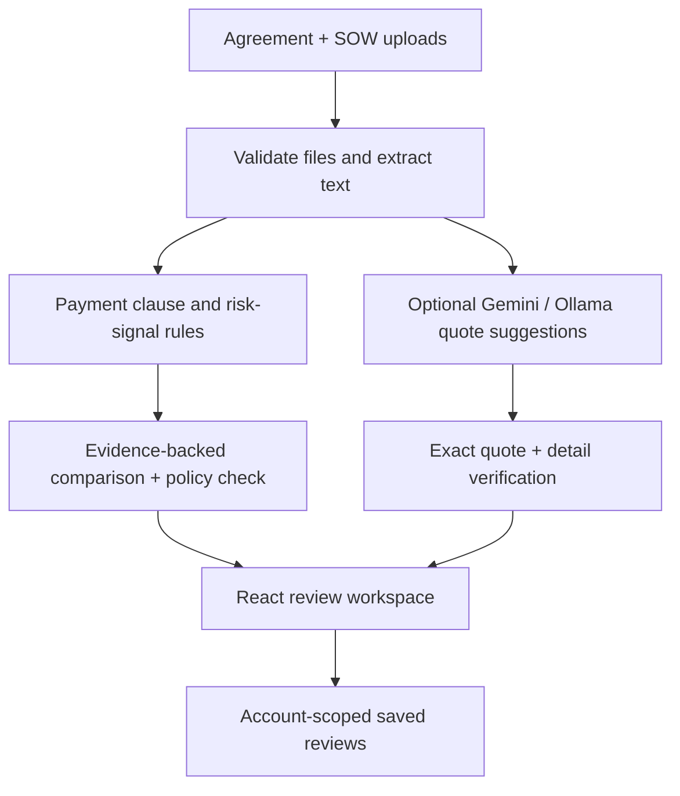

<div align="center">

# Folio — Evidence-first Contract Review

**Compare Agreements and Statements of Work with traceable evidence, structured risk signals, and optional AI-assisted quote discovery.**

[**Launch Folio**](https://folio-c4no.onrender.com/) · [**API Readiness**](https://folio-c4no.onrender.com/api/health) · [**Source Code**](https://github.com/OM2412/legal-contract-analyzer)

    

</div>

## Project at a glance

| Challenge | Folio workflow |
| --- | --- |
| Agreement and SOW payment terms are difficult to compare | Extract supported payment clauses and inspect structured side-by-side findings |
| AI answers can omit source context | Match quotations to source offsets and PDF pages before presenting them |
| Different teams apply different payment expectations | Apply a user-selected, illustrative invoice-payment threshold |
| Reviews are difficult to revisit | Save account-scoped reviews, reopen evidence and print a report |

**Demo workflow:** Open [Folio](https://folio-c4no.onrender.com/) → sign in → upload **synthetic/nonconfidential** Agreement and SOW → review evidence and Risk Studio → optionally request AI quote suggestions → save/export the review.

> **Limits:** Folio is a prototype, not legal advice. The Render address is the repository's documented public deployment; independently verified current uptime and model availability are not claimed.

# Folio — Evidence-first Contract Review

> **Published live app:** [Folio on Render](https://folio-c4no.onrender.com/) · [Database readiness](https://folio-c4no.onrender.com/api/health) · [GitHub Actions](https://github.com/OM2412/legal-contract-analyzer/actions) · [Deployment monitor](https://github.com/OM2412/legal-contract-analyzer/actions/workflows/deployment-monitor.yml).  
> **Validation boundary:** Synthetic/self-written tests are not an independent legal accuracy benchmark. Health checks don't verify Gemini response quality. Independent real-contract annotations and clearance are pending.


**Folio** is a full-stack contract-review prototype for comparing payment obligations in a software-services **Agreement** and **Statement of Work (SOW)**. It combines deterministic clause extraction, traceable source evidence, a limited risk-signal workspace, optional model-assisted quote discovery, and account-scoped saved reviews.

> **Important:** Folio is a decision-support prototype, **not legal advice**, a contract-signing authority, or a validated legal-risk classifier. A matched quote verifies what the document says—not whether the interpretation is legally correct. Always review the complete original contracts with qualified counsel when appropriate.

**Live demo:** [folio-c4no.onrender.com](https://folio-c4no.onrender.com/) · **Source:** [GitHub](https://github.com/OM2412/legal-contract-analyzer)

## Highlights

- **Paired-document comparison:** Upload Agreement and SOW as supported PDF or UTF-8 TXT files; compare payment periods, units, triggers, parties and scope where extractable.
- **Evidence before verdict:** Inspect exact quoted text, source offsets, PDF-page references and OCR provenance; the app flags unsupported or ambiguous wording for human review.
- **Policy scenario:** Apply a user-selected illustrative invoice-payment limit (default **30 days**); this is a business rule, not a legal standard.
- **Risk Studio:** Review narrow, evidence-led payment, termination and liability signals without pretending to resolve legal enforceability.
- **Optional AI quote assistant:** Gemini Developer API or an Ollama-compatible endpoint can propose payment quotes. Source-matching and payment-detail checks screen candidates; AI does **not** silently override deterministic review results.
- **Accounts and archive:** Register, log in, save, reopen, list and delete account-owned reviews with server-side access controls.
- **Responsive React UI:** Review workspace, evidence inspection, structured findings, saved reviews and browser print/PDF export.

## How the system works



**Review results and AI suggestions are separate paths.** The optional model assists discovery; it is not a legal decision engine. If no model is available, the server can return deterministic evidence-checked suggestions; that fallback is **not generative AI**.

## Technology

| Layer | Implementation |
| --- | --- |
| Frontend | React 19, Vite 8, JavaScript, CSS |
| Backend | Java 25, Spring Boot, Maven |
| Database | PostgreSQL, Spring Data JPA, Flyway migrations |
| Authentication | Spring Security, session cookies, BCrypt password hashing, CSRF protection |
| Document processing | Apache PDFBox, UTF-8 TXT, Tesseract OCR for supported scanned pages |
| AI assistance | Optional Google Gemini Developer API or Ollama-compatible model endpoint; deterministic fallback |
| Delivery | Multi-stage Docker build, Render deployment, GitHub Actions |

The Docker build compiles the Vite frontend, packages it with Spring Boot, and installs English Tesseract OCR in the runtime image.

## Quick start

### Prerequisites

- **Java 25** and Maven
- **Node.js 24** and npm for frontend development
- **PostgreSQL** for the authenticated database-backed workflow
- Optional: **Tesseract OCR** for scanned PDFs
- Optional: Gemini API key **or** a running Ollama-compatible model for model-assisted suggestions

### Backend tests

```bash
mvn test
```

### Frontend development

```bash
cd frontend
npm ci
npm run lint
npm run dev
```

For an integrated app build, run `npm run build` inside `frontend/` first, then start Spring Boot. The production Docker build performs both steps automatically.

### Run the application locally

The repository's Docker entrypoint uses `SPRING_PROFILES_ACTIVE=db` and converts `FOLIO_DB_URL` to a JDBC URL. For a **direct JVM run** against PostgreSQL, configure `SPRING_PROFILES_ACTIVE=db`, `FOLIO_DB_JDBC_URL`, `FOLIO_DB_USER` and `FOLIO_DB_PASSWORD` in your environment; do not commit their values.

```bash
mvn org.codehaus.mojo:exec-maven-plugin:3.6.4:java -Dexec.mainClass=com.omjadon.contractanalyzer.LegalContractWebApplication
```

The command above is for POSIX shells. On PowerShell, quote the main-class property as `'-Dexec.mainClass=com.omjadon.contractanalyzer.LegalContractWebApplication'`. Open **http://127.0.0.1:8080**.

A database-free demo mode is available for experimenting with document rules, but the complete **accounts and saved-review workflow requires PostgreSQL**. Use the `db` profile for the full product experience.

### Optional local AI (Ollama)

Start Ollama, then download a model such as:

```bash
ollama pull qwen3:4b
```

The default local endpoint is `http://127.0.0.1:11434`. For a hosted Ollama-compatible endpoint, configure `FOLIO_OLLAMA_URL` and, if required, `FOLIO_OLLAMA_API_KEY`. Hosted Render containers do **not** automatically include a running Ollama daemon.

## Environment configuration

Set secrets in your deployment platform or local environment—**never in Git or frontend Vite variables**.

| Variable | Purpose |
| --- | --- |
| `SPRING_PROFILES_ACTIVE=db` | Enables PostgreSQL persistence |
| `FOLIO_DB_URL` | PostgreSQL URL used by the Docker entrypoint, e.g. `postgresql://host/database?sslmode=require` |
| `FOLIO_DB_JDBC_URL` | JDBC connection URL for direct JVM runs |
| `FOLIO_DB_USER` / `FOLIO_DB_PASSWORD` | Database credentials |
| `FOLIO_AI_ENABLED` | Enables the optional AI feature on the server |
| `FOLIO_GEMINI_API_KEY` | Server-side Gemini Developer API key |
| `FOLIO_GEMINI_MODEL` | Optional Gemini model; code default: `gemini-2.5-flash` |
| `FOLIO_OLLAMA_URL` | Optional Ollama-compatible model endpoint |
| `FOLIO_OLLAMA_API_KEY` | Optional bearer token for a remote compatible endpoint |
| `FOLIO_OLLAMA_MODEL` | Optional model; code default: `qwen3:4b` |
| `FOLIO_DEMO_AUTH_ENABLED` | Optional *outer* HTTP Basic demo gate; keep `false` for the normal public sign-in page |
| `FOLIO_PASSWORD_RESET_ENABLED` | Password reset capability; keep disabled unless fully configured and verified |
| `FOLIO_PASSWORD_RECOVERY_WORKER_ENABLED` | Recovery worker; disabled by default in deployment examples |
| `SERVER_SERVLET_SESSION_COOKIE_SECURE` | Use `true` on HTTPS deployments |
| `SERVER_SERVLET_SESSION_COOKIE_HTTP_ONLY` | Use `true` |
| `SERVER_SERVLET_SESSION_COOKIE_SAME_SITE` | Example: `lax` |

When both Gemini and Ollama are configured, **Gemini takes precedence**. Model requests can send extracted contract text to the configured external service; only enable them for documents whose processing is authorized. Check provider data-handling terms. Never publish connection strings, API keys, cookies or private uploads.

## Render deployment

The repository provides `Dockerfile`, `render.yaml` and `render.accounts.yaml`. **Important:** Some Render blueprint settings and `PROJECT_STATE.md` describe older feature-branch preview arrangements. Inspect the actual service's selected branch, active environment variables and database before applying a blueprint; do not assume those historical descriptions represent the currently deployed service.

For a database-backed instance:

1. Create a PostgreSQL database (for example, an appropriately configured managed PostgreSQL service).
2. Create a Render **Docker Web Service** for this repository and select the intended deployment branch.
3. Set `SPRING_PROFILES_ACTIVE=db` plus `FOLIO_DB_URL`, `FOLIO_DB_USER` and `FOLIO_DB_PASSWORD` in Render. The Docker entrypoint derives the JDBC URL and binds to `PORT`.
4. Set `FOLIO_DEMO_AUTH_ENABLED=false` for the public registration/login UI. Enable AI only after configuring and testing the desired provider.
5. Deploy; check `/api/health`, account login, upload, review, save, reopen and delete using test documents.

**Durability note:** Free hosting tiers may sleep, have quotas, or expire. A reachable homepage alone does not prove database durability, authenticated workflows, or AI-provider availability. Plan backups, restore tests, retention rules and monitoring before storing important data.

## API overview

All endpoints below are served by the Spring Boot backend. Most application routes require an authenticated session. Browser requests must include the appropriate session cookies and CSRF token for state-changing calls.

| Endpoint | Purpose |
| --- | --- |
| `GET /api/health` | Public database readiness probe |
| `GET /api/auth/csrf` | Obtain CSRF information for the SPA |
| `POST /api/auth/register` | Create account |
| `POST /api/auth/login` / `POST /api/auth/logout` | Begin/end session |
| `GET /api/auth/me` | Current authenticated account |
| `POST /api/review` | Analyze Agreement + SOW |
| `POST /api/ai/quotes` | Optional verified payment quote suggestions |
| `GET /api/reviews?page=0` | List current account's saved reviews |
| `GET /api/reviews/{id}` | Read an owned saved review |
| `DELETE /api/reviews/{id}` | Delete an owned saved review |

**Review upload:** `POST /api/review` uses `multipart/form-data` with `agreement` and `sow` files and optional `maxDays` (integer **1–3650**, default **30**). `POST /api/ai/quotes` accepts multipart `document`. Consult the controller source for the complete response schema and persistence behavior; endpoints can evolve.

## Verification and monitoring

```bash
# Backend unit/integration tests
mvn test

# Frontend checks
cd frontend && npm ci && npm run lint && npm run build

# Public, non-destructive deployment smoke test (from repo root)
node scripts/smoke-public.mjs https://folio-c4no.onrender.com

# Real-contract evaluation intake status (not an accuracy score)
node scripts/prepare-real-evaluation.mjs status
```

`GET /api/health` returns HTTP **200** with `status: UP` when the app is ready, reporting `database: UP` if PostgreSQL is reachable (or `NOT_CONFIGURED` in database-free mode). It returns HTTP **503** on a configured database outage. Responses use `Cache-Control: no-store`.

GitHub Actions `.github/workflows/ci.yml` runs frontend lint/build, backend verification and an authenticated end-to-end smoke flow with isolated PostgreSQL. `.github/workflows/deployment-monitor.yml` performs **public, read-only** smoke checks on a schedule (every six hours) and by manual trigger. The default target is the live demo URL; the Actions variable `FOLIO_PUBLIC_URL` can override it. **A scheduled workflow is not a substitute for configured on-call alerts or uptime guarantees.**

## Supported documents and boundaries

| Area | Current behavior / limitation |
| --- | --- |
| Inputs | Supported UTF-8 TXT or PDF Agreement and SOW |
| File size | PDF up to **10 MiB** and **100 pages**; TXT up to **1 MiB** |
| Scans | Local English Tesseract OCR for pages without extractable text; at most **20 OCR pages per PDF** |
| Payments | Rule-based extraction supports a limited vocabulary and payment structures; may miss complex terms |
| AI input | Quote-assistant input limited to **12,000 Unicode code points** |
| Evidence | Quote matching proves textual presence, **not** legal interpretation |
| Output | Risk indicators and illustrative policy deviations require human assessment |
| Export | Browser print / save as PDF |

OCR may misrecognize text. Always compare identified source quotations with the scanned originals. Not all payment obligations, precedence arrangements, termination mechanisms or liability exceptions are covered.

## Evaluation integrity

This project contains synthetic development fixtures and exploratory dataset analyses. **Do not interpret those tests as real-world accuracy, legal correctness, or generalization estimates.** The documented real-contract intake identifies two candidate SEC-filed MSA/SOW sources, but currently records **zero independently labeled real-contract pairs** and **no real-world accuracy measurement**.

A defensible benchmark requires source-reuse clearance, independent blinded labeling, frozen document hashes and evaluation protocol, held-out paired agreements, error analysis and separately reported extraction/quote-verification outcomes. Details:

- [Real-contract evaluation intake](docs/real-contract-evaluation-intake.md)
- [Payment evaluation protocol](docs/payment-evaluation-protocol.md)
- [Dataset evaluation plan](docs/dataset-evaluation-plan.md)
- [Product evaluation and scoring scripts](scripts/)

Public SEC access is not automatically permission to redistribute source documents. Keep private contracts and unreleased evaluation data out of the repository.

## Security and privacy

- Backend-enforced authentication for application routes; saved reviews are scoped to the owning account.
- Spring Security session handling, SPA CSRF protection, BCrypt password hashing and authentication-rate-limit controls.
- Upload and content limits, evidence validation, restricted error responses and security-focused test scripts.
- Optional model providers may process extracted document text externally. Review this data flow before enabling third-party AI.
- Demo hosting should **not** be used for confidential client contracts without an independent security, privacy, persistence and legal review.

See [account/security API validation](docs/account-security-api-validation.md) for tested controls and remaining caveats. No software can be declared secure solely because smoke tests pass.

## Repository map

```text
frontend/                 React application
src/main/java/            Spring Boot API, auth, extraction, analysis
src/main/resources/db/    Flyway PostgreSQL migrations
testdata/                 Synthetic fixtures and development evaluations
scripts/                  Build, smoke, validation and scoring utilities
docs/                     Evaluation methods, security notes and audits
.github/workflows/        CI and deployment smoke monitoring
Dockerfile                Multi-stage deployment image
render*.yaml              Render blueprint examples
PROJECT_STATE.md          Historical project notes; may be stale
```

## Contributing

Proposed contributions that improve **evidence fidelity, unsupported-case handling, accessibility, reliability, test coverage or independent evaluation** are welcome.

1. Open an issue explaining the failing example or proposed enhancement.
2. Add a reproducible **synthetic/redacted** test case, not a private contract.
3. Keep deterministic review logic and model-assisted suggestions distinguishable.
4. Run relevant Maven tests and frontend lint/build; document limits and any new environment variables.
5. Submit a pull request describing the behavior change, evidence and remaining risks.

**Responsible disclosure:** Avoid posting sensitive documents, keys or exploitable security details in public issues. Contact repository maintainers through an appropriate private channel before disclosing a security flaw.

---

Built as an evidence-first engineering project. **Human legal review remains essential.**
